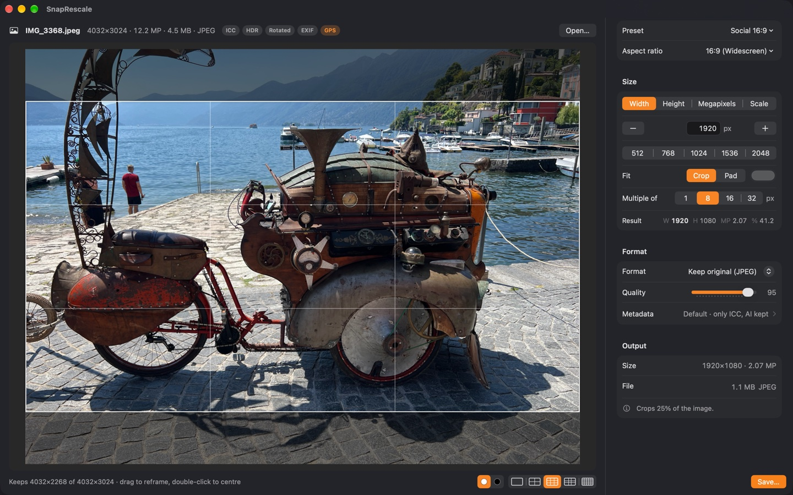

# SnapRescale

**Resize to any ratio, snapped to multiples of 8, 16 or 32.**

SnapRescale is a free, native macOS utility for resizing one image to the
dimensions your workflow needs. Choose an aspect ratio and set width, height,
megapixels or scale. Snap dimensions to multiples of 8, 16 or 32 for AI image
workflows, or use ordinary pixel dimensions.

Preview the crop before saving, drag to adjust the framing, or pad with a
chosen colour. Inspect the image's metadata and choose what stays with the
resized file; an embedded ComfyUI workflow survives a PNG-to-PNG resize. Save
useful settings as presets. Images are processed locally, without accounts or
uploads.



## Requirements and installation

- macOS 26 or later, Apple Silicon (that is what has been built and tested).
- **Mac App Store:** [Download SnapRescale](https://apps.apple.com/app/snaprescale/id6809174592).
- **Direct download:** [Download SnapRescale 1.2 (DMG)](https://github.com/phierru/SnapRescale/releases/download/v1.2-build4/SnapRescale-1.2.dmg),
  signed with Developer ID and notarised by Apple. Open the DMG and drag
  SnapRescale to Applications. See [GitHub releases](https://github.com/phierru/SnapRescale/releases)
  for release notes and checksums.
- **Build it yourself:** see [Building](#building) below.

## Using it

1. **Open an image.** Right-click it in Finder → *Open With → SnapRescale* (or
   *Services → Resize with SnapRescale*). If that launches SnapRescale, it quits
   after saving and the button reads *Save & Quit…* (*Save & Quit* when saving
   without asking). Or open SnapRescale from
   Applications, then drop an image on the window or press ⌘O; it then stays
   open.
2. **Choose the size.** Pick an aspect ratio — *Original* keeps the image's own
   ratio; the picker also offers 1:1, 2:3, 3:2, 3:4, 4:3, 9:16, 16:9 and 21:9 —
   and one number: width, height, megapixels or scale. The other three follow.
   *Multiple of 8, 16 or 32* rounds onto that lattice and says what it changed;
   *Multiple of 1* means no snapping. The preview shows the crop; drag the frame
   to reframe, or switch to *Pad*.
3. **Choose the metadata.** Click a badge next to the file name, or the
   *Metadata* row in the sidebar (⌥⌘I), to open the inspector. EXIF, GPS,
   IPTC, XMP and the AI workflow each have a *Keep · Strip* switch, and the
   colour profile has *Keep · sRGB · Strip*; the default strips EXIF, GPS,
   IPTC and XMP and keeps the colour profile and the AI workflow.
4. **Save.** ⌘S opens the save panel, pre-filled with `name_WxH`. Settings can
   make ⌘S save beside the original without asking (it asks for each folder
   once). The file size shown before saving is a real encode.

Brief in-app help is on ⌘?; the same text is in [docs/HELP.md](docs/HELP.md).
Version history is in the [changelog](CHANGELOG.md).

## What it does and doesn't do (1.2)

- One image at a time. Output formats: JPEG, PNG, HEIC, TIFF, or the source's
  own format when it is one of those.
- **Metadata is kept or stripped per section, never edited.** By default EXIF,
  GPS, IPTC and XMP are stripped, and the colour profile and AI workflow data
  are kept, prompts included: review them before sharing. A resized ComfyUI
  PNG saved as PNG still opens its workflow in ComfyUI; A1111-style parameters
  travel in the EXIF user comment of JPEG, HEIC and TIFF. C2PA content
  credentials are always stripped, and the embedded EXIF thumbnail is never
  written. Metadata over the per-image read limits is left out, and the
  inspector says so. Copy and export work whatever the switches say.
- **Colour:** the source's profile is kept, converted to sRGB or left out.
  Sources deeper than 8 bits give 16-bit PNG and TIFF, and 10-bit HEIC. CMYK
  sources are converted to sRGB, and HDR gain maps are not written.
- Orientation is baked into the pixels. Animated images use their first frame.
- Presets store size, export and metadata settings as plain JSON you can edit
  and share.
- Planned next: WebP and per-format encoder options, then multiple windows.
  See [docs/ROADMAP.md](docs/ROADMAP.md) and the [changelog](CHANGELOG.md).

## Building

Prerequisites: Xcode 26 (Swift 6.2), [xcodegen](https://github.com/yonaskolb/XcodeGen)
and librsvg for the icon (`brew install xcodegen librsvg`), Python 3 (ships
with Xcode's command line tools).

```sh
./Scripts/build-app.sh                        # fast dev build, unsandboxed → build/SnapRescale.app
open -a build/SnapRescale.app photo.heic      # or launch it and drop an image on the window
./Scripts/build-xcode.sh Release              # store-style build: sandboxed, hardened → build/xcode/SnapRescale.app
swift test --package-path RescaleKit          # the engine's tests
swift test --package-path SnapRescale         # the app's tests (presets)
```

The Xcode project is generated from `project.yml`; the `.xcodeproj` is not
committed. Under the sandbox, files must arrive by Open With, drop, ⌘O or
Services — a path in `--args` is not readable there, which is why the dev
build exists. The app icon is a macOS 26 Liquid Glass package,
`SnapRescale/AppIcon.icon`; `Scripts/make-icns.sh` rasterises the flat
fallback. Release and App Store steps are in [docs/RELEASING.md](docs/RELEASING.md).

### Layout

- `RescaleKit/` — the engine: solver, image pipeline, metadata reading and
  writing, presets. No UI. A throwaway `rescale` CLI exercises it (`--write` writes a
  file; without it, it only prints the solve).
- `SnapRescale/` — the SwiftUI app.
- `prototype/` — the Python model of the solver the Swift port is checked
  against (5,940-case parity fixture).
- `docs/` — [PRD](docs/PRD.md), [roadmap](docs/ROADMAP.md), [help](docs/HELP.md),
  [what the badges detect](docs/reference/image-metadata.md), reviews.

## Licence

MIT — see [LICENSE](LICENSE). The same text ships inside the app bundle.

## Acknowledgements

Inspired by the *Resize Image/Mask* and *Resolution Selector* nodes in
[ComfyUI](https://github.com/comfyanonymous/ComfyUI), whose way of thinking
about resizing — aspect ratio plus one number, snapping to a multiple — is the
starting point. SnapRescale implements its own resizing solver and macOS image
pipeline; the aspect-ratio names in the picker are theirs. ComfyUI is GPL-3.0
and none of its code is used. Provenance notes: [docs/reference/comfyui-node-review.md](docs/reference/comfyui-node-review.md).

I thank the ComfyUI team and contributors for the excellent work.

Support and bug reports: [issues](https://github.com/phierru/SnapRescale/issues).
Privacy: [docs/PRIVACY.md](docs/PRIVACY.md) — nothing leaves your Mac.
